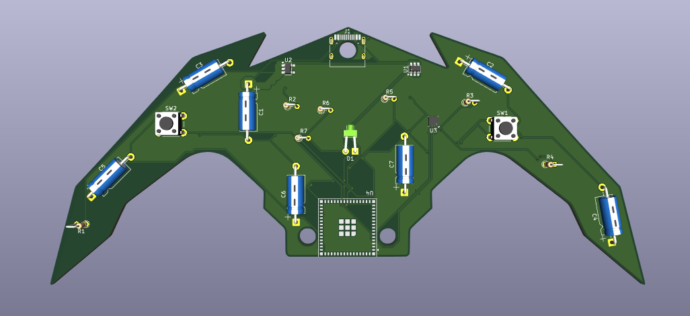
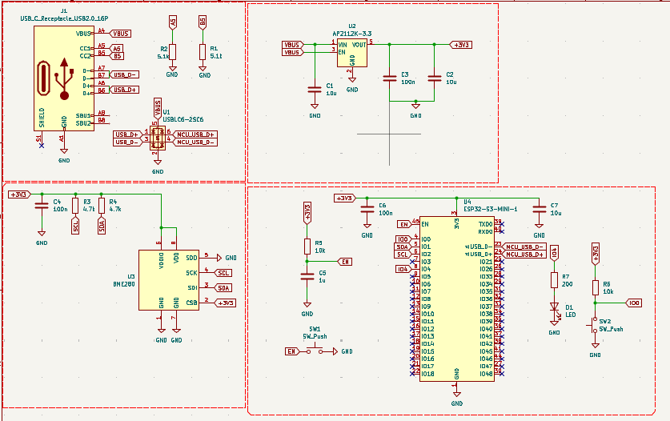
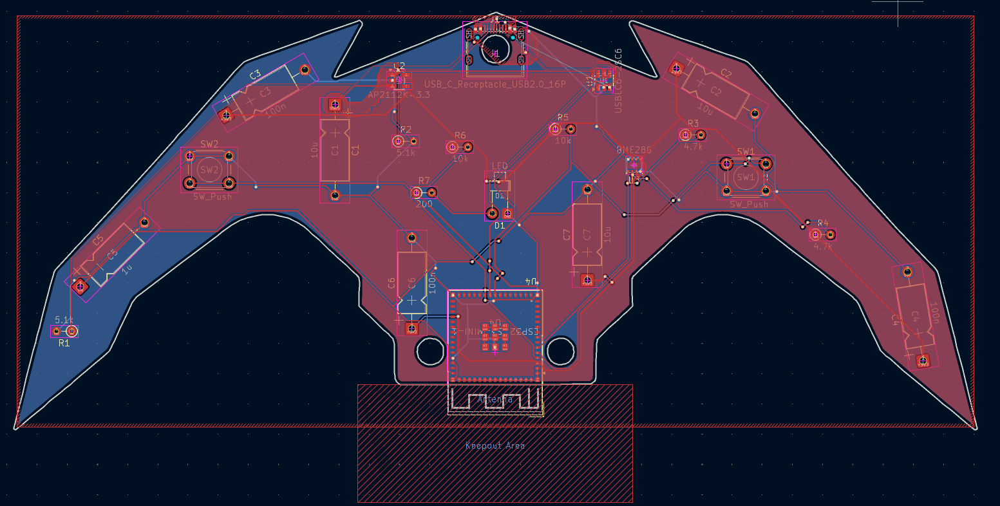
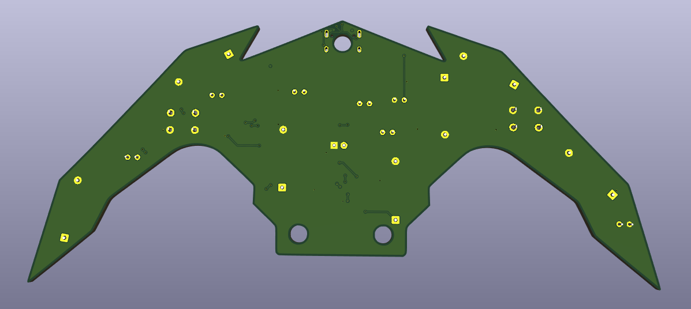

# Batarang ESP32-S3 IoT Badge 🦇⚡

Une carte de développement IoT personnalisée en forme de **Batarang**, conçue autour du microcontrôleur **ESP32-S3-MINI-1** et équipée d'un capteur environnemental **BME280**.

## 📌 Aperçu du Projet

Ce projet combine une forme de PCB personnalisée (*Batarang*) avec une architecture matérielle complète pour des applications IoT embarquées (station météo portable, badge connecté, nœud de capteurs Wi-Fi/Bluetooth). Il intègre les meilleures pratiques de conception électronique (DFM, protection ESD, découplage localisé et intégrité de signal).

## 🚀 Caractéristiques Techniques

| Composant | Référence / Spécification | Description | 
| ----- | ----- | ----- | 
| **Microcontrôleur** | **ESP32-S3-MINI-1** | Wi-Fi $2.4\text{ GHz}$, Bluetooth 5 (LE), Antenne PCB intégrée, $8\text{ MB}$ Flash, $512\text{ KB}$ SRAM | 
| **Capteur Environnemental** | **BME280** | Mesure de température, humidité relative et pression atmosphérique (I2C) | 
| **Alimentation / LDO** | **AP2112K-3.3** | Régulateur LDO $3.3\text{ V}$ / $600\text{ mA}$ à faible chute de tension (*Low Dropout*) | 
| **Connectique** | **USB-C (16 broches)** | Interface d'alimentation $5\text{ V}$ et de programmation USB native | 
| **Protection ESD** | **USBLC6-2SC6** | Protection contre les décharges électrostatiques sur les lignes de données USB | 
| **Boutons** | 2x Boutons poussoirs | **SW1** (Reset / EN) & **SW2** (Boot / IO0) | 
| **Affichage Signalétique** | LED SMD / THT | **D1** (LED utilisateur reliée à `IO4`) | 

## 📐 Architecture Générale du Schématique

## 🔍 Explications Détaillées des Blocs du Circuit

### Partie 1 : Interface USB-C & Protection ESD (`J1`, `U1`)

#### Fonctionnement technique :

* **Négociation de Puissance USB-C (`J1`) :** Les broches `CC1` ($A5$) et `CC2` ($B5$) de l'embase USB-C sont chacune tirées à la masse via une résistance dédiée `R1` ($5.1\text{ k}\Omega$) et `R2` ($5.1\text{ k}\Omega$). Ce pont informe la source d'alimentation (hôte USB ou chargeur) que le module est un périphérique récepteur (*Sink/UFP*) et déclenche la délivrance du rail $V_{\text{BUS}}$ ($5\text{ V}$).

* **Compatibilité et Réversibilité :** Les broches de données $A6$/$B6$ (`USB_D+`) et $A7$/$B7$ (`USB_D-`) sont reliées deux à deux sur le connecteur pour garantir la transmission des données USB $2.0$ quel que soit le sens d'insertion du câble.

* **Protection contre Surtensions Transitoires (`U1` - USBLC6-2SC6) :** Les lignes de données passent obligatoirement à travers le composant de protection ESD avant d'atteindre le microcontrôleur. En cas de décharge électrostatique lors du branchement à chaud (*Hot-plug*), les diodes TVS internes dérivent la surtension vers le plan de masse (`GND`), protégeant l'étage logique de l'ESP32.

### Partie 2 : Étage d'Alimentation & Régulation LDO (`U2`)

#### Fonctionnement technique :

* **Régulation de Tension (`U2` - AP2112K-3.3) :** Le composant convertit la tension d'entrée $V_{\text{BUS}}$ ($5\text{ V}$) issue de l'USB en une tension fixe et régulée de $3.3\text{ V}$ (`+3V3`) capable de fournir jusqu'à $600\text{ mA}$.

* **Activation Automatique :** La broche `EN` (broche 3) est directement câblée à $V_{\text{BUS}}$, ce qui garantit le démarrage immédiat du régulateur dès la mise sous tension de la carte.

* **Filtrage Capacitif et Stabilité :**

  * `C1` ($10\ \mu\text{F}$) stabilise la tension d'entrée et absorbe les pics d'appel de courant à la connexion.

  * `C2` ($10\ \mu\text{F}$) fournit une réserve d'énergie locale en sortie pour maintenir la tension stable lors des appels de courant.

  * `C3` ($100\text{ nF}$) filtre les bruits résiduels et perturbations à haute fréquence sur le rail `+3V3`.

### Partie 3 : Capteur Environnemental BME280 (`U3`)

#### Fonctionnement technique :

* **Communication Bus I2C :** Le capteur communique avec le microcontrôleur via les lignes de bus `SDA` (données) et `SCL` (horloge). Les résistances de tirage `R3` ($4.7\text{ k}\Omega$) et `R4` ($4.7\text{ k}\Omega$) tirent les lignes vers `+3V3`, ce qui est requis pour le bus I2C à drain ouvert.

* **Configuration du Mode I2C :** La broche `CSB` (Chip Select) est maintenue au niveau haut (`+3V3`) pour désactiver la fonction SPI et forcer le mode I2C.

* **Adresse I2C Statique :** La broche `SDO` est reliée à la masse (`GND`), fixant l'adresse de bus I2C du composant à **`0x76`** (si elle était reliée à `+3V3`, l'adresse deviendrait `0x77`).

* **Filtrage Alimentation :** Le condensateur `C4` ($100\text{ nF}$) assure le découplage des broches `VDD` et `VDDIO`.

### Partie 4 : Microcontrôleur ESP32-S3 & Periphériques de Contrôle (`U4`)

#### Fonctionnement technique :

* **Cœur de Traitement (`U4` - ESP32-S3-MINI-1) :** Module équipé d'un processeur double cœur $32\text{ bits}$ opérant jusqu'à $240\text{ MHz}$, gérant la communication sans-fil Wi-Fi/BLE et le contrôleur USB matériel natif.

* **Circuit Reset Temporisé (`EN` - Broche 45) :**

  * La résistance de pull-up `R5` ($10\text{ k}\Omega$) reliée à `+3V3` et le condensateur `C5` ($1\ \mu\text{F}$) vers `GND` créent une constante de temps $RC \approx 10\text{ ms}$.

  * Cela maintient l'ESP32 sous Reset pendant le temps nécessaire à la stabilisation complète de l'alimentation $3.3\text{ V}$.

  * Le bouton `SW1` permet un Reset manuel à tout moment.

* **Sélecteur de Mode Boot (`IO0` - Broche 4) :**

  * La ligne `IO0` est tirée au niveau haut par `R6` ($10\text{ k}\Omega$) pour démarrer normalement sur le firmware en mémoire Flash.

  * L'appui sur le bouton `SW2` lors d'un Reset force `IO0` à la masse, basculant l'ESP32 en mode Bootloader/Flashage USB.

* **Découplage Hautes Performances :** Les condensateurs `C7` ($10\ \mu\text{F}$) et `C6` ($100\text{ nF}$) sont placés immédiatement contre la broche `3V3` du module pour absorber les pics de courant générés par le transmetteur radio Wi-Fi.

* **Interface Utilisateur :** La LED `D1` reliée à l'GPIO `IO4` avec sa résistance de limitation `R7` ($200\ \Omega$) sert de témoin visuel ou d'indicateur d'état du programme.

## 🎨 Conception du PCB & Layout DFM

### Choix de Conception :

1. **Forme Personnalisée (`Edge.Cuts`) :** Découpe mécanique sous forme de Batarang.

2. **Gestion des Plans de Cuivre :**

   * **Face Supérieure (`F.Cu`) :** Plan d'alimentation dédié au rail `+3V3`.

   * **Face Inférieure (`B.Cu`) :** Plan de masse continu `GND` assurant un faible retour d'impédance et un bon blindage CEM.

3. **Zone Inoccupée Antenne (`Keepout Area`) :** Zone entièrement dégagée de cuivre, de composants et de plan de masse sous l'antenne méandre du module **ESP32-S3-MINI-1** pour maximiser le rayonnement radio.

## 🖼️ Galerie 3D

| Face Avant (Top View) | Face Arrière (Bottom View) | 
| ----- | ----- | 
|   |   | 

## 📦 Nomenclature des Composants (BOM)

| Désignation | Empreinte / Boîtier | Valeur | Quantité | Rôle | 
| ----- | ----- | ----- | ----- | ----- | 
| **U4** | ESP32-S3-MINI-1 | ESP32-S3 | 1 | Microcontrôleur principal | 
| **U3** | LGA-8 ($2.5 \times 2.5\text{ mm}$) | BME280 | 1 | Capteur Température / Humidité / Pression | 
| **U2** | SOT-23-5 | AP2112K-3.3 | 1 | Régulateur LDO 5V -> 3.3V | 
| **U1** | SOT-23-6 | USBLC6-2SC6 | 1 | Diode de protection ESD USB | 
| **J1** | SMD 16 Pins | USB-C Receptacle | 1 | Connecteur d'alimentation et data USB | 
| **SW1, SW2** | Push Button $6 \times 6\text{ mm}$ | SW_Push | 2 | Boutons Reset (EN) & Boot (IO0) | 
| **D1** | LED 3mm / 1206 | LED | 1 | Témoin lumineux utilisateur sur IO4 | 
| **R1, R2** | 0805 / 0603 | $5.1\text{ k}\Omega$ | 2 | Résistances Pull-down USB CC | 
| **R3, R4** | 0805 / 0603 | $4.7\text{ k}\Omega$ | 2 | Résistances Pull-up Bus I2C | 
| **R5, R6** | 0805 / 0603 | $10\text{ k}\Omega$ | 2 | Résistances Pull-up EN / Boot | 
| **R7** | 0805 / 0603 | $200\ \Omega$ | 1 | Resistance de limitation pour LED D1 | 
| **C1, C2, C7** | 0805 / Radial | $10\ \mu\text{F}$ | 3 | Condensateurs de filtrage et réservoir | 
| **C3, C4, C6** | 0805 / Axial | $100\text{ nF}$ | 3 | Condensateurs de découplage HF | 
| **C5** | 0805 / Axial | $1\ \mu\text{F}$ | 1 | Condensateur de retard Reset | 

## 💻 Flash & Programmation

1. Connectez la carte à votre ordinateur via le câble USB-C.

2. Si le flash automatique ne s'exécute pas automatiquement :

   * Maintenez le bouton **Boot (`SW2`)** enfoncé.

   * Appuyez brièvement sur le bouton **Reset (`SW1`)**.

   * Relâchez le bouton **Boot (`SW2`)** pour placer l'ESP32-S3 en mode *Download*.

3. Transférez votre code via **Arduino IDE** (choisir la carte `ESP32S3 Dev Module`) ou **PlatformIO**.

## 📜 Licence

Ce projet est publié sous licence **MIT**. Vous êtes libre de l'utiliser, le modifier et le distribuer.